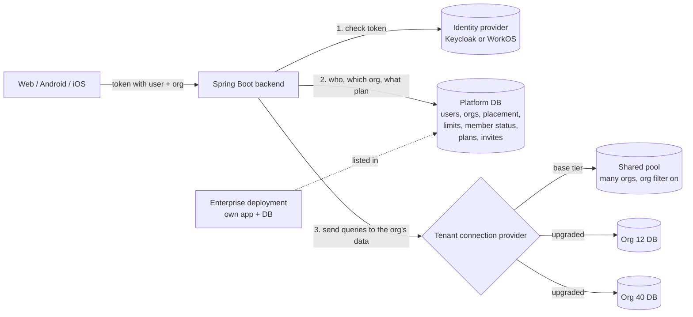

# Auth, Tenancy and Plan Tiers

_As of 2026-10-28 · Draft for team discussion_

> Committed as written on 2026-10-28, for review with the code. Where it differs from [Access Matrix and Identity Provider](2026-10-30-access-matrix-and-identity-provider.md), that design note is the current decision.

This doc covers:

- how orgs, users and plan tiers should work, and how we price them
- where each org's data lives
- whether to stay on Keycloak or move to WorkOS
- which domains become switchable, priced modules
- the order we build it in

**How to read it:**

| If you are… | Read |
| --- | --- |
| Product, pricing or management | [Summary](#summary), [Current priority](#current-priority-the-matrix-then-workos), [Part 1](#part-1-product-rules) (including [Pricing](#pricing-tiers-or-base-plus-add-ons)), [Part 5](#part-5-modularization-plan) phases and totals, [Before deciding](#before-deciding), [Decisions needed](#decisions-needed) |
| Backend | Everything, especially [Current priority](#current-priority-the-matrix-then-workos), [Part 2](#part-2-architecture), [Part 4](#part-4-rollout-plan), [Part 5](#part-5-modularization-plan) and [Architecture improvements](#architecture-improvements) |
| Web and mobile | [Summary](#summary), [Part 1](#part-1-product-rules), [Roles and permissions](#roles-and-permissions), [Part 3](#part-3-identity-providers), offline workers under [Before deciding](#before-deciding) |

---

## Summary

1. **Three tiers.**
   - **Base (most users):** create 1 org, join many.
   - **Multi-org:** create several orgs, join many.
   - **Enterprise:** their own dedicated deployment.
2. **Base-tier orgs share one database; paying tiers can get their own.** A database for every org would mean thousands of databases for mostly small, free orgs. The platform database records where each org's data lives, so moving an org is a setting plus a copy job.
3. **Three limits push a base org to upgrade:** storage space, a maximum number of projects, and modules locked to higher plans. Our billing code already models all three, so the work is mostly enforcement and UI.
4. **Roles and permissions stay in our own tables**, not in Keycloak or WorkOS. The identity provider only answers "who is this user, and which orgs are they in".
5. **Joining, leaving and removal go through our backend.** Removal takes effect immediately.
6. **Priority: the Roles & Permissions matrix first, then the move to WorkOS.** With roles in our tables, WorkOS only holds logins and memberships. See [Current priority](#current-priority-the-matrix-then-workos).
7. **Settle five questions before committing:** demand for dedicated databases, the CockroachDB licence, data residency, the full cost of running Keycloak, and offline field workers. See [Before deciding](#before-deciding).
8. **Authentication is pluggable.** A customer can bring their own provider (WorkOS, Keycloak, Auth0, Okta, Entra ID…) and switch later without losing data. Most customers connect it through our broker over SSO; enterprise customers can have tokens accepted from their provider directly. See [Pluggable authentication](#pluggable-authentication).
9. **Start three improvements now:** put the identity provider behind an interface, add row-level security to the shared pool, and add an outbox for changes that touch several systems. See [Architecture improvements](#architecture-improvements).
10. **Price modules one by one (recommended).** A base bundle plus priced modules and options (storage blocks, project packs, isolated workspace), chosen when an org is created, with preset bundles as shortcuts. See [Pricing](#pricing-tiers-or-base-plus-add-ons).
11. **Modularize every sellable domain.** Chat, Risk, Labour, Assets, Workforce, Finance, Inventory and Procurement become modules; project, task, issues, comments and WBS stay as the core bundle. About 16–23 developer-weeks. See [Part 5](#part-5-modularization-plan).

---

## Current priority: the matrix, then WorkOS

**Decided:** build the Roles & Permissions matrix first, then move sign-in to WorkOS.

- **Why the matrix comes first:** once permissions come from our tables, WorkOS only has to hold logins and memberships. If WorkOS went first, today's Keycloak org roles would have to be recreated in WorkOS and then thrown away.
- **What waits:** dedicated databases, à la carte pricing and the wider modularization follow the same plan in this doc, after these two tracks.

**Today's checks** (details in [Permission Mapping](2026-10-30-access-permission-mapping.md)): 944 endpoints check access in five ways.

| How they check | Endpoints |
| --- | --- |
| Fixed role names, with six roles in use | about 500 |
| Any member | about 210 |
| Keycloak permission names such as `vendor:read` (63 names); probably held by nobody | 141 |
| Domain security beans | 93 |
| Platform admin; never set up, so nobody holds it | 22 |

The mapping is cross-checked against the plain-language roles guide, Who Can Do What, which is on the ticket and not kept in the repo. That guide also proposes a 27-role structure for a typical construction company. The matrix is built so it can express that structure later, without the structure being needed on day one.

### Track 1: Roles & Permissions matrix (about 5–8 weeks)

1. **Data model**, scoped to each org:
   - roles and their permissions: module × view, create, edit, approve, delete, plus named permissions within a module, such as `progress-bills: certify` or `finance: company books`
   - a scope on every grant, saying which records it covers:
     - All
     - Assigned projects
     - Related: only records linked to the person, so a client sees only the bills on their own project
     - Own
   - departments and groups, with members and grants
   - user role assignments
   - a link from outside users to their customer or vendor record, which the Related scope uses
   - user overrides
   - grantable roles: which roles a role's holders may hand out
   - the preparer stored on records that get approved

   It matches the web UI's types, extended with these parts. See [Beyond module × action](2026-10-30-access-permission-mapping.md#beyond-module--action).
2. **Permission lookup:** roles + groups + overrides, filtered by project where the assignment has one. Cached in Redis by org and user, and cleared on change.
3. **Spring Security:** `JwtAuthConverter` adds `<module>:<action>` authorities from the lookup. Aliases for the old Keycloak names (`:read` to view, `:update` to edit, `:admin` to all five) are added only if a token check shows anyone holds those permissions. The roles guide says nobody does.
4. **Seed and migrate:**
   - Standard roles are seeded with the same names as today, plus a base Member role, from the mapping's seed table. The role-name checks keep working on day one.
   - Each user's Keycloak group memberships become role assignments.
   - The `hasAuthority` endpoints are retired where a newer endpoint covers them, and converted otherwise.
5. **Convert checks module by module** to permission checks, starting with the smallest. This is what makes custom roles work. Each conversion runs the module's `*AuthzTest`, and adds the project check and the preparer-vs-approver check where the module needs them. About 2–4 weeks of the total.
6. **API and web:** build the endpoints for the Roles & Permissions tab, swap the web's mock data layer for them, and add the types to `echno-core`. The tab groups its rows under the roles guide's 12 areas, and enforces grantable roles.
7. **Retire the Keycloak side:**
   - Stop creating `org-N/<role>` subgroups.
   - Remove the permission-token swap behind a flag.
   - Turn `platform-admin` into a flag in our database.
   - Move the Keycloak admin endpoints from company admins to platform admin only.
8. **After go-live, fix the weak spots** the seed copies on purpose: open attachments, contractor bills readable by everyone, project managers getting the whole finance area, and HR able to grant any role. See [Weak spots copied on day one](2026-10-30-access-permission-mapping.md#weak-spots-copied-on-day-one).

### Track 2: WorkOS (about 5–8 weeks; starts once Track 1 step 3 is live)

1. **Identity provider interface** (create user, membership, change email, sign out), with Keycloak as the first implementation.
2. **WorkOS environments** (staging and prod) with a default `member` role only, a custom domain and session timeouts.
3. **The backend accepts both Keycloak and WorkOS tokens**, so older mobile builds keep working.
4. **Import users with their password hashes, then memberships**, and store `workos_user_id`.
5. **Web:** `@workos-inc/authkit-nextjs`, email sign-in with first and last name (middle name in our database), and WorkOS invitations tied to the invited email.
6. **Mobile:** generic OIDC sign-in with PKCE, released before the cutover.
7. **Cut over, then remove Keycloak.**

Step 5 also fixes three open ClickUp issues: the name mix-up at registration, changing email, and invites that don't check the email.

### Sequence

| Weeks | Track 1: Matrix | Track 2: WorkOS |
| --- | --- | --- |
| 1–2 | Steps 1–3: tables (with scopes on every grant), lookup, authorities | Step 1 (interface), step 2 (WorkOS staging) |
| 3–4 | Step 4: seed and migrate; the matrix goes live with today's checks | Step 3 (both token types), and the import script tested on staging |
| 5–8 | Steps 5–6: convert checks, wire up the web tab | Steps 4–6: import, web, mobile releases |
| 9–10 | Step 7: retire Keycloak roles; step 8 starts | Step 7: cutover, remove Keycloak |

**Timing:**

- **Two developers, one per track:** about 10 weeks.
- **One developer:** about 14–16 weeks, Track 1 first.

**Done so far:** the [permission mapping](2026-10-30-access-permission-mapping.md), Track 1's first input. It has a CSV of every endpoint with its proposed module and action, and it's cross-checked against the roles guide.

---

## Glossary

| Term | Meaning |
| --- | --- |
| Org | A customer workspace (company). Called organization or tenant elsewhere. |
| Identity provider | The service that signs users in: Keycloak today, possibly WorkOS later, or a customer's own (Auth0, Okta, Entra ID…). |
| Broker | Our default identity provider. It can sign users in through a customer's own provider over SSO. |
| Identity link | A record tying a user's account at a provider (issuer + subject) to our user id. One user can have several. |
| Membership | The fact that a user belongs to an org. Stored in the identity provider and mirrored in our member records. |
| Platform database | One central database for things that span orgs: users, the org list, plans, limits, invites, where each org's data lives. |
| Org database | Where an org's own data lives: projects, attendance, inventory, finance and so on. |
| Shared pool | One database that holds many base-tier orgs, kept apart by an org filter. |
| Dedicated database | A database that holds only one org. |
| Placement | Where an org's data lives: shared pool, dedicated database, or a dedicated deployment. |
| Entitlement | What an org's plan allows: which modules, and how much of each limit. |
| Module | A feature area (for example Finance) that can be switched on or off per org and priced on its own. |
| Core bundle | Project, task, issues, comments and WBS: always on for every org. |
| Add-on | Anything bought on top of the base: a module, a storage block, a project pack, an isolated workspace. |
| 402 | The error the backend returns when a plan doesn't allow an action. |

---

## Part 1: Product rules

### Tiers

| | Base (most users) | Multi-org | Enterprise |
| --- | --- | --- | --- |
| Orgs a user can create | 1 | Several, limit set by plan | Orgs inside their own deployment |
| Orgs a user can join | Many | Many | Their own; outside guests by invite |
| Projects per org | Up to x | Higher or no limit | No limit |
| Storage | Base quota | Higher quota | By contract |
| Modules | Base set; some locked | More or all | All |
| Where data lives | Shared pool | Dedicated database (if the tier includes it) | Own deployment: app, database, storage |
| Tenant admin tools | Members, roles, leave and remove | Plus SSO and domain checks | Plus directory sync, audit logs, separate backups |

### Pricing: tiers or base plus add-ons

There are two ways to sell this. They use the same modules, limits and placement underneath.

| | Option A: fixed tiers | Option B: base plus add-ons (recommended) |
| --- | --- | --- |
| What the customer picks | One of Base, Multi-org, Enterprise | The base bundle, plus any modules and options, with a live monthly price |
| Base bundle | Part of every tier | Project, task, issues, comments and WBS; free or low cost, with base limits |
| Modules (finance, workforce, inventory…) | Set by tier | Priced one by one; required modules are added automatically |
| Capacity | Set by tier | Storage blocks (for example 50 GB) and project packs (for example 5 projects) |
| Isolated workspace | Included in some tiers | A paid add-on, priced to cover a dedicated database |
| More than one org | A Multi-org tier | One free base org per user; each further org has its own paid subscription |
| Hitting a limit | Jump to the next tier | Add the block, pack or module that's needed |
| Enterprise | Custom | Custom |

**Recommendation: Option B, with 2–3 preset bundles** (for example "Site team" or "Full company") shown first at a discount, and "customize" as the second path. Pure à la carte at sign-up stalls people who don't yet know what they need. Per-module trials help them find out.

**What Option B changes in this doc:**

- **The "which tier gets a dedicated database" question goes away.** Isolation is an add-on.
- **Choosing isolation when creating an org is cheap.** The org starts on a fresh database, so the copy job is only needed when isolation is added later.
- **The create limit becomes simpler.** One free base org per user, and every further org pays for itself.
- **Modularization is a prerequisite.** A domain can only be priced on its own once it's a module (see [Part 5](#part-5-modularization-plan)). Until then, it can only be gated endpoint by endpoint with `@RequireSubscription`.

**What already exists:**

- **Line items per org:** `SubscriptionItem` has `feature`, `quantity`, `unitPrice`, `overrideQuotaLimit` and `overrideEnabled`.
- **Module dependencies:** `ModuleManifest.dependsOn`.
- **Per-org module gating:** through `entitlementFeatureKey`.

**What's missing:**

| Work | Estimate (one developer) |
| --- | --- |
| Plan checks read line items and overrides. Today nothing reads `subscriptionItems`; access comes from the plan alone. | 3–5 days |
| A price catalog for modules and options, with versions so existing customers keep their price, plus one price calculator in the backend (dependencies, GST, annual discount) | 1–1.5 weeks |
| Variable-amount payment collection. `GatewayPlanMapping` maps one plan to one Razorpay plan id, so we either update the subscription on each change, use a unit-priced plan with quantity = total, or raise a monthly invoice charged against an e-mandate. | 1.5–3 weeks |
| Org-creation wizard and billing page (web): pick modules and options, see the price | 1–1.5 weeks |
| Mid-cycle changes and invoices: removals at the end of the period, additions now with a prorated charge, one GST invoice line per item | 1–2 weeks |
| **Total, on top of modularization** | **~5–8 weeks** |

**Things to watch:**

- **Razorpay and RBI rules.** Check how Razorpay handles recurring add-ons. Also check the RBI e-mandate limit: as I understand it, auto-debits above ₹15,000 need the customer to approve each payment. `MandatePolicy` suggests this has been looked at.
- **Keep the price list short.** A handful of modules and fixed-size blocks, not arbitrary amounts.
- **Lock messages.** "Why can't I see finance?" becomes a common support question. Lock messages in the apps must name the add-on that's missing.
- **Seats.** `Plan` has a user cap. Decide whether price depends on seats (per seat, or per module per seat). It changes the calculator a lot.

### Creating and joining orgs

- **The create limit belongs to the user, not the org.**
  - Each user has a `max_owned_orgs` value: 1 on base, raised by plan, and changeable for one user by a platform admin.
  - It counts orgs the user owns now, so deleting or handing over an org frees a slot.
- **Joining has no limit by default.** An org can be marked "exclusive" so its members can't belong to any other org. This is mainly for enterprise customers on the shared deployment.
- **Only our backend creates orgs.** That keeps the create check in one place.

### Joining, leaving and removal

| Action | Who | What happens |
| --- | --- | --- |
| Join | Invited user, or someone with an invite code | Checks that the invite's email matches the signed-in user and that the org isn't exclusive. Creates the membership and the member record, and gives the default role. |
| Leave | The user | Ends the membership, marks the member "left" and clears their roles. |
| Remove | Org admin | Same as Leave, plus a reason and who did it. The user can be re-added later. |
| Suspend | Org admin | A temporary removal. The member record stays, so roles come back on reinstatement. |
| Delete org | Owner | Needs confirmation and frees the owner's create slot. Data is kept for a grace period, then dropped. |

Rules that apply to all of them:

- **The last owner can't leave.** They hand the org over first, or delete it. A handover to someone already at their create limit is blocked.
- **Removal is immediate.** The backend checks member status on every request (cached), so it doesn't wait for the user's token to expire.
- **History stays.** Attendance, approvals and other records keep the person's id and their name at the time.

### Limits that trigger an upgrade

| Limit | Base tier | Checked when | At the limit |
| --- | --- | --- | --- |
| Orgs a user owns | 1 | Creating an org | Can't create another; upgrade prompt |
| Projects per org | x active projects | Creating or unarchiving a project | Can't add a project; existing ones keep working |
| Storage per org | Base quota | Before an upload starts | New uploads blocked; viewing, downloading and deleting still work |
| Locked modules | Some modules off | Opening the module or calling its API | Shown with a lock and an upgrade prompt; data kept |

- **Storage:** the owner gets an email at 80%, and the billing page shows a usage bar.
- **Projects:** only active projects count. Archiving one frees a slot.
- **Locked modules:** the plan check runs before role permissions, so a role can't open a module the plan doesn't include. The Roles & Permissions tab shows locked modules greyed out.
- **Downgrading never deletes data.**
  - Extra projects stay, but no new ones can be added until the org is under the limit.
  - Locked modules hide their data until the org upgrades again.
  - Over-quota storage blocks new uploads only.

### Upgrading and downgrading: what the user sees

1. The owner pays (Razorpay).
2. **Immediately:** the new limits and modules apply, and the create limit goes up.
3. **If the new tier includes a dedicated database:** the org moves in the background. The owner chooses "now" or "tonight".
   - During the move the org is read-only for seconds to minutes, with a clear "upgrading your workspace" message.
   - The owner gets an email when it's done.
4. **Only the org the user owns moves.** Orgs they've merely joined stay where their own owner's plan puts them.
5. **New orgs created after the upgrade** start on a dedicated database.
6. **Downgrade** takes effect at the end of the billing period. The org moves back to the shared pool, and its dedicated database is kept for a grace period, then dropped.

---

## Part 2: Architecture

### Where we are today

| Area | Today |
| --- | --- |
| Sign-in | Keycloak 26.0.7. next-auth on web; PKCE browser sign-in on Android and iOS. |
| Org roles | Keycloak groups such as `org-5/system-admin`, put into the token and read by `JwtAuthConverter`. |
| Permissions | `KeycloakAuthorizationService` swaps the token for a Keycloak permission token and reads permissions from it. |
| Platform admin | A Keycloak client role, read from `resource_access`. |
| User and group management | The backend's Keycloak admin client (`KeycloakUserProvisioningService`, `KeycloakInitializer`), about 11 files. |
| Tenancy | One shared CockroachDB database. The `X-Organization-Id` header picks the org; a Hibernate `orgFilter` adds `organization_id = ?` to queries (`echno-backend/docs/MULTI_TENANCY_FILTER_GUIDE.md`). |
| Billing | `Plan`, `Feature` (`BOOLEAN`, `QUOTA`, `RATE_LIMIT`), `PlanFeature` (`enabled`, `quotaLimit`, `quotaPeriod`), `UsageRecord`. `Subscription` is per org. |
| Plan checks | `@RequireSubscription` on 18 endpoints and `ModuleEntitlementResolver`, returning 402. `EntitlementPolicy` runs in `ADVISORY` mode (logs only) until payments go live. |
| Files | `FileStorageService`: one DigitalOcean Spaces bucket, presigned upload URLs. |
| Migrations | Liquibase 5.0.1. |

### How the pieces fit

On every request:

1. Check the token with the identity provider's keys.
2. Read the user, the org, the member status and the org's plan from the platform database. All of this is cached in Redis.
3. Send the org's queries to its placement.

### Roles and permissions

The identity provider doesn't hold our org roles.

| | Identity provider | Our tables |
| --- | --- | --- |
| Who the user is, sign-in, sessions | Yes | |
| Membership in an org | Mirrored where the provider has orgs (WorkOS) | Yes, the source of truth, with status |
| Default role | `member` on every membership; otherwise ignored | |
| Widget admin role (WorkOS only, if we embed widgets) | Holds `widgets:users-table:manage`, `widgets:sso:manage`, `widgets:domain-verification:manage` | Our roles decide who gets it |
| Job roles (Director, PM, Store Keeper…) | | Yes, in each org's database |
| Module × action matrix (view, create, edit, approve, delete), plus named permissions within a module | | Yes |
| Department and group grants, per-user overrides | | Yes |
| Scope on every grant (All, Assigned projects, Related, Own) | | Yes |
| Grantable roles, approval limits, preparer-vs-approver rule | | Yes |
| Platform admin | | A flag in the platform database |

**Why we keep roles ourselves:**

- **Changes apply on the next request.** Provider role changes only show up after the session refreshes. Our lookup is cached in Redis by org and user, and the cache is cleared when roles or the matrix change.
- **Each org can have its own roles.** Standard roles are copied from a template when an org is created.
- **The matrix is too detailed for provider roles.** It's about 30 rows under 12 areas × 5 actions, plus named permissions, a scope on every grant, group grants and overrides.
- **Switching providers doesn't touch roles.**

**What we give up:**

- **Role assignment happens in our Users tab, not a provider widget.**
- **Mapping a customer's SSO or directory groups to roles is our job.** We'd handle the directory group events by webhook, with a per-org mapping in the Roles & Permissions tab.
- **Permissions aren't in the token.** Every check goes through the backend or its cache.

**Changes from today:**

- The `org-N/<role>` groups go away.
- The permission-token swap is replaced by a lookup in our tables.
- `JwtAuthConverter` reads only the user and the org from the token.
- The plan check (entitlement) always runs before the permission check.

### Where each org's data lives

| Placement | Who | How orgs are kept apart |
| --- | --- | --- |
| Shared pool | Base tier | Hibernate org filter (already built) |
| Dedicated database | Paying tiers that include isolation | Separate database; the filter stays on as a second safeguard |
| Dedicated deployment | Enterprise | Separate app, database and storage |

**Why not a dedicated database for every org:** most orgs will be small base-tier orgs. Thousands of databases means thousands of connection pools and migration runs, and the base tier doesn't pay for that. If we still decide to give every org its own database, the pool and migration measures below become mandatory.

**Implementation notes:**

- Use Hibernate's built-in multi-tenancy (`MultiTenantConnectionProvider`, `CurrentTenantIdentifierResolver`) rather than a bare `AbstractRoutingDataSource`. It keeps one `EntityManagerFactory`, and it keys the second-level cache by tenant.
- The token says who the user is; our membership table says which orgs they may use. The `X-Organization-Id` header picks the active org and is checked against that table on every request (cached). This keeps the routing the same whichever provider signed the user in (see [Pluggable authentication](#pluggable-authentication)).
- Put dedicated databases in the same CockroachDB cluster at first. Connection details live in the platform database, so a large customer can later move to its own cluster with no code change.
- Don't use a Keycloak realm per org. A user in two orgs would become two accounts, and Keycloak slows down as realms pile up.

### Moving an org to a dedicated database

The move is a one-time copy job. The same job handles downgrades (in reverse) and enterprise moves (with the target in their deployment).

1. **Create the database.** Run the full Liquibase changelog and mark the org "moving".
2. **Make the org read-only.** Writes get a clear "upgrading" error; reads keep working.
3. **Copy the rows.** Copy every row with that `organization_id`, in foreign-key order, keeping the same primary keys. URLs, ids cached on mobile, file keys and platform references all keep working.
4. **Check.** Compare row counts and checksums on the key tables. On a mismatch, stop. The shared copy is untouched, so the org just goes back to read-write.
5. **Switch.** Point the placement at the new database and clear the cached placement on every backend instance (Redis pub/sub). Then allow writes again.
6. **Clean up later.** Keep the old rows for a grace period (for example 7 days), then delete them in batches. Once writes land in the new database, undoing the move means copying back, so the check comes before the switch.

**Before the first move:**

- **Audit every table** as org-scoped (it moves) or platform-level (it stays). Anything that links two orgs, or has no `organization_id`, needs fixing first. The filter guide's section on explicit joins is a starting list.
- **Background jobs and schedulers** that loop over orgs must go through the tenant connection provider.
- **Files** don't move if object keys are per org inside the shared bucket.
- **Search indexes, reports and caches** are rebuilt or re-pointed after the switch.
- **Larger orgs:** if even a short read-only window is too long, CockroachDB changefeeds can stream changes during the copy. Base-tier orgs don't need this.

### Enforcing plan limits

**Storage:**

- **Keep a running byte total per org.** Upload adds to it once the upload is confirmed; delete subtracts. Summing `UsageRecord` rows on every upload would be slow.
- **Check before handing out the upload URL**, and sign the declared file size into it. Files go straight to the bucket, so checking afterwards is too late.
- **Reconcile nightly** by listing the org's objects. This needs object keys that start with the org id. Check whether today's `folder` keys do; if not, new uploads should, and old ones need a one-time count.
- **Database size isn't counted at first.** Files are almost all of the space, and counting rows per org is expensive.

**Projects:**

- **Use `projects.max`** (`QUOTA`, `TOTAL`).
- **Count and insert in one transaction.** CockroachDB transactions are serializable by default, so two creates at once can't both pass. The loser retries and gets the 402.

**Locked modules:**

- **Use one `BOOLEAN` feature per module**, for example `module.finance`.
- **Enforce on the server** with `@RequireSubscription` and the module resolver.
- **Show it in the apps.** Web and mobile read entitlements once per session and show locks in the navigation.

**Turning enforcement on:**

1. Seed the base plan with its quotas and locked modules, and give every existing org a subscription row.
2. Run in `ADVISORY` for a few weeks. The warnings list the orgs already over a limit.
3. Contact those orgs, or raise their limits for a while, then switch to `ENFORCE`.
4. Map each 402 reason (`quota_exceeded`, `feature_not_in_plan` or similar) to a specific upgrade message on web and mobile.

### Infrastructure trade-offs

**Connection pools.** A database connection belongs to one database, so every dedicated database needs its own pool on every backend instance. For example, 500 databases × 5 idle connections × 3 instances = 7,500 connections before any traffic.

- **Pools start empty:** Hikari `minimumIdle=0`, a small `maximumPoolSize` (3–5) and a short `idleTimeout`. Create pools on first use, and close the least recently used ones above a cap.
- **The shared pool serves most orgs** with one pool. This is the main reason for tiered placement.
- **Add a pooler** (PgBouncer in transaction mode, or a managed one) if dedicated databases reach the hundreds. Check CockroachDB's current guidance first.
- **Serverless Postgres (Neon, for example)** scales idle databases to zero and is a later option. Moving off CockroachDB is a separate decision.
- **Set connection alerts** per database and in total before the first dedicated database goes live.

**Migrations.** Liquibase can run against any connection, so the per-org runner loops over the platform database.

1. **Run migrations as a separate job, not on app startup.**
2. **Order:** platform database, then the shared pool, then dedicated databases in parallel batches (for example 10 at a time).
3. **Record progress per org:** schema version, status, last run, last error. A failed org is retried on its own.
4. **Use expand-and-contract changes:** add first, remove in a later release, so old and new app versions both work.
5. **Block an org whose schema is behind** with a clear "being updated" error.
6. **A new dedicated database** runs the full changelog before the org is marked ready.
7. **Enterprise deployments** run the same job in their own stack.

**Other effects:**

- **Backups and restores** for one org are simple with a dedicated database, which is a selling point.
- **Export or deletion** of an org's data is a single operation.
- **Cross-org reports and platform search** must fan out, or read from a reporting store.
- **Monitoring** needs per-org labels: slow queries, size and connections.

---

## Part 3: Identity providers

### Pluggable authentication

**Goal:** a customer can sign in with the authentication service they prefer (WorkOS, Keycloak, Auth0, Okta, Entra ID, Google and so on), and can switch later without losing their users or data.

**Principle:** the identity provider only proves who the user is. Everything else is ours: users, memberships, roles, plans and placement. Once that holds, a provider is configuration plus one small adapter, and switching providers never touches org data.

#### Two ways a customer brings their own provider

| | A. Federation through our broker (default) | B. Direct provider (enterprise, on request) |
| --- | --- | --- |
| How it works | Our broker (Keycloak today, or WorkOS) signs the user in through the customer's provider over SAML or OIDC. Our apps only ever see our broker's tokens. | The backend accepts tokens issued directly by the customer's provider, such as their Auth0 or Okta tenant. |
| Covers | Okta, Entra ID, Google Workspace, Auth0, ADFS, any SAML or OIDC provider | Customers whose policy says tokens must come from their own tenant |
| Changes in our apps | None. One sign-in flow, one token format | Backend accepts several issuers; apps discover which provider to use per org |
| Switching provider | Change the org's SSO connection in the broker | Change the org's provider record; users re-link on next sign-in |
| Effort | Small: SSO setup per org | Medium: built once, then configuration per customer |
| Where | Shared deployment | Dedicated deployments first; shared deployment only if a deal needs it |

**Recommendation:** use A for almost every customer. It's the standard pattern, and both Keycloak (identity brokering) and WorkOS (SSO connections) do it out of the box. Build B once, for the first customer that requires it, and use it mostly on dedicated deployments.

#### What we build so either way works

1. **An identity link table** in the platform database: provider, issuer, subject (the provider's user id), and our user id.
   - A user can have several links, one per provider they've signed in with.
   - Our user id never changes, so switching providers only adds a link.
2. **An authentication provider record per org** in the platform database: the type (broker, OIDC or SAML), issuer, client id, allowed email domains and status.
3. **A provider adapter interface** with two halves:
   - **Sign-in (every provider):** turn a provider's token into our principal (user, email, email verified), by mapping its claims.
   - **Management (optional):** create user, change email, sign out sessions. Not every provider supports this, and nothing depends on it.
4. **Memberships, roles and the active org in our tables.** The token only tells us who the user is. The org comes from the user's selection (the `X-Organization-Id` header), checked against our membership table on every request (cached).
   - This reverses an earlier choice in this doc: we no longer rely on a provider's `org_id` claim.
   - On WorkOS we still mirror memberships, but the source of truth is ours.
5. **Issuer-aware token checking.** Spring's `JwtIssuerAuthenticationManagerResolver` picks the right keys for each trusted issuer. The list of trusted issuers comes from the provider records, and unknown issuers are rejected.
6. **Sign-in routing by email domain.** The user types their email, we look up the domain's org and its provider, and send them to the right sign-in page. Users without a matching domain use our default broker.
7. **Standard OIDC with PKCE everywhere.** Web and mobile already use it.
   - The apps fetch the provider config for the email domain from the backend, so a new provider needs no app release.
   - The Android and iOS sign-in code needs a generic OIDC client instead of Keycloak-specific endpoints (`AuthEndpoints`, `KeycloakTokenService`).

#### Safety rules

- **Only link accounts by email for domains the org has verified.** Otherwise someone could set up their own provider with a victim's email address and take over the account.
- **Each provider record lists the domains it may sign in.** A token from Org A's provider can't sign in an Org B user.
- **The platform database decides what's allowed.** Provider claims about roles or orgs are ignored, unless the org explicitly maps directory groups to our roles.
- **Session lifetime is enforced by our backend.** Providers differ in how they refresh and log out, so the per-request member status check applies to all of them.
- **MFA and password rules belong to the customer's provider** when they bring their own. Our broker's rules apply to everyone else.

#### When a customer switches provider

1. Add the new provider record next to the old one, with both active.
2. Users sign in with the new provider. Their verified email matches their existing user, and a new identity link is added. No data moves.
3. Once everyone has signed in (or by a set date), deactivate the old provider.
4. Users who never signed in during the overlap re-link by email verification on their next sign-in.

Passwords don't move between providers. They belong to the provider. This only matters when users had passwords in our own broker; it's not an issue for customers who bring their own provider.

#### What this costs

- **Platform database:** two tables (identity links and provider records) and the domain-based sign-in routing.
- **Backend:**
  - one adapter per provider type: a generic OIDC adapter covers most providers, a SAML one only if we accept SAML directly
  - the issuer resolver
  - membership checks from our tables
- **Web:** a generic OIDC sign-in using the provider config from the backend, plus the email-first sign-in page.
- **Mobile:** a generic OIDC client and the email-first sign-in screen.
- **Per customer:** a provider record, a verified domain, and a test sign-in.

### Default broker: Keycloak or WorkOS

Parts 1 and 2 are the same work on either broker, and either works with the pluggable setup above. The choice affects running costs, the tenant admin tools we get ready-made, and how much code changes.

### At a glance

| | Keycloak (stay) | WorkOS (move) |
| --- | --- | --- |
| Org in the token | Header + group check today; Keycloak 26 Organizations may give a single-org token (to confirm) | `org_id` in every access token |
| Join and leave | Backend adds and removes memberships (already does) | Backend creates and deactivates memberships; a webhook catches joins WorkOS makes itself |
| Exclusive orgs | Simple: only our backend creates memberships | Backend, plus webhook and a sign-in Action |
| Customer sets up their own SSO | We build it | Built in |
| Directory sync (SCIM) | Plugin or our own build | Built in |
| Tenant admin pages | We build all of it | Admin Portal and widgets, next to our Roles & Permissions tab |
| Enterprise isolation | Separate realm or instance | Separate environment, or their SSO on the shared one |
| Running it | We run, upgrade and back it up | Hosted |
| Cost | Our infrastructure only | Sign-in free up to 1M monthly users; SSO and directory sync priced per connection (check current pricing) |
| Code change | Small | Large: web, backend and both mobile apps |

**Decision:** move to WorkOS, after the Roles & Permissions matrix is live. See [Current priority](#current-priority-the-matrix-then-workos). The Keycloak column stays here for reference.

### Where memberships can come from

| Source | Keycloak | WorkOS |
| --- | --- | --- |
| Our invite, join and remove endpoints | Check rules, then add or remove the membership | Check rules, then create or deactivate the membership |
| Automatic join by verified email domain | Off unless we turn it on | `organization_membership.created` webhook; deactivate it if it breaks a rule |
| Sign-in through the customer's SSO or directory | Needs a custom Keycloak plugin to block it | Same webhook, plus an Authentication Action that blocks the sign-in |
| Invite from the WorkOS User Management widget | Not applicable | Same webhook |

- **WorkOS Actions** run only at sign-in and registration, so the webhook covers joins a few seconds after they happen.
- **Deactivating a WorkOS membership** signs out all of that user's sessions, not just the one for that org.

### Tenant admin dashboard

Neither provider gives each tenant its own admin console. On both, the tenant dashboard is our organization page.

| What tenant admins do | Keycloak | WorkOS |
| --- | --- | --- |
| Invite, remove, suspend users | We build it (the backend has most of the calls) | Widget for invites; removal goes through our backend so member records stay in step |
| Roles & Permissions | Our existing tab | Our existing tab |
| Set up their own SSO | We build a form that creates and links an identity provider | Admin Portal link |
| Directory sync (SCIM) | Plugin or our own build | Admin Portal |
| Prove they own their email domain | We build a DNS check | Admin Portal |
| Audit logs | We build them from Keycloak events and our own | Built in |
| Sessions and profile | We build them | Widgets |

- **The Keycloak admin console isn't for tenants.** On 26.0.7 it can't cleanly limit an admin to one org, and it shows realm-wide settings. The newer permission system in 26.2 still shows them.
- **One WorkOS environment per tenant** only makes sense for enterprise isolation, because a user in two orgs would become two accounts.

### Enterprise sign-in

1. **Default: shared provider, with their SSO required on their org.** Users keep one account if they also belong to orgs on the shared deployment.
2. **On request: a separate environment, realm or instance.** Full isolation, but shared users end up with two accounts.

### WorkOS notes, if we move

- **Social logins** can't be carried over. Users re-link by matching email.
- **Names:** WorkOS stores first and last name only. A middle name goes in our database or user metadata.
- **Password hashes** carry over. Keycloak 26 uses argon2 by default (older accounts may use pbkdf2), and WorkOS accepts both in PHC format, so nobody resets their password.

---

## Part 4: Rollout plan

### Phase 1: Foundations (either provider)

Start with the improvements marked "Start now" in [Architecture improvements](#architecture-improvements): the identity provider interface, row-level security in the shared pool, the outbox, and the org id in shared keys plus isolation tests. The steps below build on them.

1. **Build the platform database:** users, orgs and their placement, create limits, member status, plans, invites.
2. **Add the create limit and the Join, Leave, Remove and Suspend endpoints**, with the per-request member status check.
3. **Move org roles from Keycloak groups into our role tables.** Wire the Roles & Permissions UI to them, and switch permission checks to the cached lookup.
4. **Make memberships ours, and add identity links.** Add the identity link and provider record tables, with the Keycloak broker as the first provider. Check the active org against our membership table. This is the base for pluggable authentication.

### Phase 2: Plan limits

5. **Seed the base plan** with the project limit, storage quota and locked modules, and give every org a subscription row.
6. **Add the storage tracking** and the check before upload, plus the project limit check.
7. **Show usage, locks and upgrade prompts** on web and mobile.
8. **Run in advisory mode, then switch to enforce.**

### Phase 3: Dedicated databases

9. **Add Hibernate multi-tenancy** with the shared pool as the only placement. Nothing moves yet.
10. **Build the per-org migration job** and the progress table.
11. **Audit every table** as org-scoped or platform-level. Build the copy job (read-only gate, check, switch) and try it on an internal org.
12. **Set pool limits and alerts**, then offer dedicated databases on the tiers that include them.

### Phase 4: Enterprise

13. **Package the stack for a dedicated deployment** when the first enterprise deal needs it.
14. **Accept tokens directly from a customer's provider** when the first customer requires it. That means the generic OIDC adapter, the issuer resolver, email-first sign-in on web and mobile, and the switch-over flow. Until then, customers' own providers connect through our broker over SSO.

### Provider track, run alongside

**If we stay on Keycloak:**

1. Confirm whether Keycloak 26 Organizations can give a single-org token (`organization:<alias>` scope). If yes, move org membership onto it; if not, keep the header plus group check.
2. Build the tenant admin pieces in the org page: members, sessions, audit logs.
3. Build self-serve SSO and domain checks only when a customer needs them.

**If we move to WorkOS:**

1. Set up staging and prod environments, a default `member` role (plus a widget admin role if we embed widgets), a custom auth domain and session timeouts.
2. Make the backend accept both Keycloak and WorkOS tokens (`JwtIssuerAuthenticationManagerResolver`), so old mobile builds keep working.
3. Import users with password hashes, then orgs and memberships. Store the id mapping, make the script safe to re-run, and test real sign-ins.
4. Switch the web app to `@workos-inc/authkit-nextjs`, pausing sign-ups briefly.
5. Ship mobile releases on WorkOS, then force an update.
6. Add the membership webhook and the sign-in Action. Embed the Admin Portal and widgets in the org page.
7. Remove Keycloak: the admin client, initializer, permission-token swap, the `dev/keycloak` container and testcontainers-keycloak.

---

## Part 5: Modularization plan

**Goal:** every domain that can be priced, switched on and off, or handed to one developer becomes a module on the existing module system. The core bundle and the platform stay as they are.

### What the module system already gives us

Every module plugs in the same way through `common/module`:

- **Manifest:** a module provides one `EchnoModule` bean with a `ModuleManifest`. It declares id, version, entitlement key, dependencies, permissions and navigation.
- **Per-org switch:** `ModuleRegistry` combines an operator kill switch (`echno.modules.<id>.enabled`), the org's entitlement and the module's dependencies.
- **Migrations:** each module ships its own Liquibase files under `db/changelog/modules/`.
- **Enforced boundaries:** `ModuleBoundaryTest` (ArchUnit) checks that the core reaches a module only through its API, that modules reach each other only through their APIs, and that module entities are scoped to an org.
- **Already modules:** inspections (184 files), work progress (68), BIM (44), toolbox talks (23).

It's a modular monolith: modules are compiled into the one app and switched on per org. Runtime plug-in jars and microservices are out of scope by design (`echno-backend/docs/specs/2026-08-26-modular-plugin-architecture.md`).

### Target map

**Platform (always on, not a module):** `common`, `organization`, `user`, `auth`, `keycloak`, `billing`, `aspect`, `search`, `pdfGeneration`, `projectInviteCode`, `documentReversal`, `employee`, and `vendor` as shared master data.

**Core bundle (always on):** `project`, `task`, `issue`, `IssueComment`, `wbs`, `category`.

**Modules:**

| Module | Packages | Java files | Lines | Depends on | Effort (one developer) |
| --- | --- | --- | --- | --- | --- |
| Chat | `chat` | 36 | ~2.3k | None | 2–4 days |
| Risk | `risk` | 10 | ~0.9k | None | 2–3 days |
| Labour | `labour` | 13 | ~0.8k | None | 2–3 days |
| Assets | `asset` | 15 | ~1.9k | None (adds asset lines to site transfers when on) | 1–1.5 weeks |
| Workforce | `attendance`, `leave`, `holiday` | 153 | ~16.8k | None | 2–3 weeks |
| Finance | `finance`, `expense`, `receipt`, `payable` | 167 | ~12.7k | None | 3–4 weeks |
| Inventory | `material`, `storageLocation`, `inventoryTransaction`, `materialConsumption`, `stockAdjustment`, `siteTransfer`, `siteTransferItem` | 99 | ~11.9k | None | 3–4 weeks |
| Procurement | `indent`, `indentItem`, `purchaseOrder`, `purchaseOrderItem`, `goodsReceivedNote`, `grnItem`, `subcontract` | 68 | ~7.2k | Inventory | 2.5–3.5 weeks |
| Inspections, Work progress, BIM, Toolbox talks | already modules | None |: | Work progress: Finance and Procurement for contract billing | Manifest and pricing only |

The counts come from scanning the packages and their imports. They show where the coupling is; they're not a line-by-line review.

### What ties these domains to the core today

The same few patterns cause almost all of the coupling. Fix each pattern once, in the groundwork, and every module after that gets easier.

| # | Pattern | Where | Fix |
| --- | --- | --- | --- |
| 1 | Core entities hold collections of module records | `Employee` (10 `@OneToMany`, including GRNs, indents, POs, payables, inventory, materials, site transfers), `WbsElement` (6: indents, POs, payables, consumption, subcontracts), `Vendor` (6) | Drop the inverse collections; the module keeps the foreign key and offers a query by employee, WBS or vendor id. DTOs and mappers that embed them (for example `VendorDto` with payables) call the module's API instead. |
| 2 | One attachment table with a column per owner | `Attachment` has `attendance_id`, `clock_event_id` and similar | Owner type plus owner id, with a data migration |
| 3 | Domain events in `common` carry module entities | `GrnCreatedEvent`, `SiteTransfer*Event`, `MaterialConsumedEvent`, `InventoryEventListener` in `common/events` | Events move to the publishing module's API package and carry ids; listeners move into the module that reacts |
| 4 | Org onboarding calls module seeders directly | `OrganizationOnboardingSeeder` calls finance (cost categories, chart of accounts, settings) and leave (policy defaults) | Seeders run from the module's `onEnable`. The hook exists but nothing calls it yet. |
| 5 | Document reversal knows every document type | `documentReversal` imports payables, GRNs, POs, inventory, leave notifications | A reversal handler interface; each module registers handlers for its own documents |
| 6 | A core service lives inside a module | The notification service is in `leave`, used by document reversal and low-stock alerts | Move it to `common` |
| 7 | Core data lives inside a module | `ShiftTiming` (attendance), used by employee and invite codes; `Customer` (finance ledger), used by `ProjectService` | Move `ShiftTiming` to `employee` and `Customer` to `project` |
| 8 | Inventory rules live in `common` | `OpeningStockValidator`, the inventory parts of `AttachmentService` | Move them into Inventory |
| 9 | Site transfers load assets directly | `SiteTransferAssetLines`, `SiteTransferItem → Asset` | A "transfer line handler" extension point in Inventory, implemented by Assets |

### Phases

**Phase 0: Groundwork (3–4 weeks).** Fix patterns 1–8, and set up the shared pieces:

- **Lifecycle hooks:** call `onEnable` and `onDisable` when an org's entitlements change.
- **API convention:** an `api` package per module, which is what the ArchUnit rule already checks.
- **Entitlement features:** seed `MODULE_<ID>` features for every module.
- **Roles & Permissions matrix:** drive its module rows from `ModuleRegistry`, so it lists only installed modules and greys out locked ones.
- **Mobile:** an endpoint that tells the apps which modules are enabled.
- **Liquibase:** leave existing changesets where they are (moving them changes their identity); new changesets go in `db/changelog/modules/<id>/`.

**Phase 1: Quick wins (1.5–2 weeks).** Chat, Risk, Labour. Nothing in the core depends on them, so they prove the path end to end: manifest, entitlement, navigation gating, permissions, pricing line.

**Phase 2: Assets (1–1.5 weeks).** Add the transfer-line extension point (pattern 9), then move `asset`.

**Phase 3: Workforce (2–3 weeks).** With the notification service, shift timing and attachments already fixed, move attendance, leave and holiday. Clock-in and leave are mostly used on phones, so mobile gating matters most here.

**Phase 4: Finance (3–4 weeks).**

- **Decide where payables live.** Either they stay platform data as the payables side of purchasing (cheaper), or they move into Finance and Procurement creates them through Finance's API. Recommended: move them into Finance, since pattern 1 removes the entity links anyway.
- **Expose a Finance API** that Work progress and Procurement call.

**Phase 5: Inventory (3–4 weeks).** Material is the most widely used record (14 packages). After patterns 1 and 3, the remaining users are inside Inventory or in Procurement.

**Phase 6: Procurement (2.5–3.5 weeks).**

- **Manifest:** it declares `dependsOn: inventory`.
- **WBS:** loses its links to indents, POs and subcontracts (pattern 1); budget views ask Procurement for the totals.
- **Subcontracts** go here, because Work progress uses them for contract billing.

**For every module (part of each estimate):**

1. Move the packages under `modules/<id>/` and add an `api` package.
2. Write the manifest: entitlement key, dependencies, permissions, navigation.
3. Gate the web routes and navigation, and add the `echno-core` package entries.
4. Move the tests, and run `ModuleBoundaryTest` until it passes.
5. Check that turning the module off keeps its data, and that turning it back on loses nothing.

### Total effort

| Work | Estimate (one developer) |
| --- | --- |
| Phase 0: groundwork | 3–4 weeks |
| Phases 1–6: modules | 13–19 weeks |
| **Backend plus web gating** | **~16–23 weeks** |
| Mobile gating (Android and iOS) | +2–4 weeks per app, spread across the phases |
| À la carte pricing (if Option B) | +5–8 weeks |

With two developers working on separate modules after the groundwork, this is about **3–4 months** of calendar time. Each phase ends with a module that can be priced and switched on per org, so pricing can start with the quick wins before everything is done.

---

## Before deciding

Settle these five before choosing a provider or committing to dedicated databases. Any of them can change the answer.

| # | Question | Why it matters | How to settle it |
| --- | --- | --- | --- |
| 1 | Does anyone need a dedicated database yet? | Phase 3 is the most expensive part of this plan | List the customers or deals asking for isolation, compliance or data residency |
| 2 | What is our CockroachDB licence? | It sets the cost of every dedicated deployment, and whether Postgres is worth comparing | Check the licence and terms for v26.2.4 |
| 3 | Must any customer's data stay in India or a chosen region? | Placement becomes "which region", not just "which database" | Ask sales and check enterprise contract templates against the DPDP Act |
| 4 | What does running Keycloak really cost? | Free to license, but someone runs it | Estimate monthly hours and hosting, next to WorkOS pricing at our expected user count |
| 5 | How long can field workers stay offline? | Instant removal and short tokens clash with phones with no signal on site | Agree an offline session limit and how queued actions are re-checked |

### 1. Do we need dedicated databases now?

Unless a customer is asking for isolation, build only the routing layer: one placement field in the platform database, plus the tenant connection provider. It costs little.

The copy job, the per-org migrations and the pool measures can wait for the first deal that needs them. The routing layer keeps them easy to add.

### 2. CockroachDB licence

- **We run v26.2.4.** From v24.3, CockroachDB dropped its free Core edition. As I understand it, free use now needs an Enterprise Free licence, which is limited to companies under a revenue threshold and requires sending usage data to Cockroach.
- **Price dedicated deployments with this in mind.** Every enterprise deployment and dedicated cluster falls under the licence.
- **Compare Postgres now.** Self-hosted Postgres, or Neon for dedicated databases, is worth a side-by-side before tier prices are set.

### 3. Data residency

India's DPDP Act, and many enterprise contracts, may require data to stay in India or in a region the customer chooses. Adding a region field to placement now is cheap. Adding it after orgs have been placed means moving them.

### 4. Full cost of Keycloak

Licensing is free, but we still pay for:

- high availability
- upgrades (we're on 26.0.7; 26.2 and later exist)
- backups
- being on call when sign-in goes down

Put a monthly figure on that next to WorkOS pricing.

### 5. Offline field workers

Construction sites mean phones that are offline for hours.

- **Set how long an offline session may last** before the app needs to sign in again.
- **Re-check every queued action** against member status and permissions when it syncs. Otherwise a removed worker's queued actions still land.
- **Show the worker** which actions were rejected and why.

This rule is the same on Keycloak and WorkOS. Only the refresh mechanics differ.

---

## Architecture improvements

These help whichever provider we choose and whether or not we build dedicated databases. Items 1–3 are worth starting now.

| # | Improvement | Fixes | Priority |
| --- | --- | --- | --- |
| 1 | Identity provider behind one interface | A later Keycloak-to-WorkOS move rewriting code across about 11 files | Start now |
| 2 | Row-level security in the shared pool | The Hibernate filter silently missing explicit joins and native SQL | Start now |
| 3 | Outbox for changes that touch several systems | Membership out of step between the identity provider and our databases | Start now |
| 4 | Keep the platform database off the hot path | One database outage taking every org down | With Phase 1 |
| 5 | Member snapshot in each org's database | Names and avatars can't be joined across databases | With Phase 3 |
| 6 | Per-org rate limits and fair job queues | One org's heavy use slowing everyone else | With Phase 2 |
| 7 | Org id in every shared key, plus isolation tests | Data leaking through Redis, files or search | Start now; tests in CI |
| 8 | Audit log of admin actions | Enterprise requirements and debugging membership problems | With Phase 1 |

### 1. Identity provider behind one interface

Wrap `KeycloakUserProvisioningService`, the group service and `KeycloakInitializer` behind the provider adapter interface described in [Pluggable authentication](#pluggable-authentication).

- **Sign-in half:** map a token to our principal.
- **Management half (optional):** create user, change email, sign out sessions.

The Keycloak version is the first implementation, and a generic OIDC adapter is the second. A WorkOS or Auth0 version becomes a new class, not a change across the codebase.

### 2. Row-level security in the shared pool

- **The gap:** our filter guide says explicit joins and native SQL slip past the Hibernate filter without any warning.
- **The fix:** with row-level security, the database itself refuses rows from another org, whatever the query.
- **Check first:** CockroachDB added row-level security in recent versions, so confirm that v26.2 has it.
- **Keep the filter as well.** Most orgs will live in the shared pool, so this matters more than dedicated databases do.

### 3. Outbox for changes that touch several systems

Join, leave, remove and upgrade each touch three systems: the identity provider, the platform database and the org's database. Today the only safeguard is the manual Keycloak rollback in `registerUser`.

- **Record the change first.** Write it to an outbox table in the same transaction as the platform database change.
- **Apply it with retries.** A worker applies it to the other systems, and every step is safe to repeat.
- **Check for drift nightly.** Compare memberships across the three systems and flag any mismatch.

### 4. Keep the platform database off the hot path

Every request needs the user, member status, placement and plan.

- **Cache all four in Redis**, clearing each when it changes.
- **Give the platform database high availability**, and consider read replicas.
- **Decide what happens when Redis is down:** fall back to the database, and refuse requests only if both are unavailable.

### 5. Member snapshot in each org's database

Org records refer to users in the platform database, and names and avatars can't be joined across databases. So each org database keeps a small member table (name, avatar, status), refreshed through the outbox. This also keeps history readable after someone leaves.

### 6. Per-org rate limits and fair job queues

A dedicated database doesn't stop one org from slowing others inside a shared app or cluster.

- **Rate limits:** use the existing `RATE_LIMIT` feature type for per-org API limits.
- **Job queues:** give background jobs (exports, reports, inspections) a fair queue per org, so one org's big export doesn't hold up everyone else's work.

### 7. Org id in every shared key, plus isolation tests

- **Put the org id in every shared key:** Redis keys, file paths and search index entries, not just database rows.
- **Add isolation tests to CI** that try to read another org's data through each API. They can build on the authorization tests we already have.

### 8. Audit log of admin actions

From day one, record every removal, suspension, role change, upgrade and data move: who, when, from where and why. Enterprise buyers ask for it, and it's the first thing needed when membership looks wrong.

### Two small proofs before committing

1. **Copy job:** move one internal org end to end to a dedicated database, then back.
2. **WorkOS sign-in:** run the web app's sign-in against a free WorkOS staging environment.

---

## Decisions needed

### Product and pricing

- What are the base-tier numbers: the project limit x, the storage quota, and which modules are locked?
- Tiers (Option A) or base plus add-ons (Option B)? Recommended: B, with 2–3 preset bundles.
- If Option A: does every higher tier include a dedicated database, or only some?
- If Option B: the price of each module, storage block, project pack and the isolated workspace, and the preset bundles.
- Is price per seat, per module per seat, or flat per org?
- On the multi-org tier, are project and storage limits per org, or pooled across the orgs one owner pays for?
- Is the create limit part of a user's own plan, or of a billing account that owns several orgs?
- For enterprise: shared provider with required SSO (one account), or a separate environment (two accounts)?
- Which customers or deals need a dedicated database now? If none, Phase 3 waits.
- Must any customer's data stay in India or in a region they choose?
- Which customers need their own authentication service, and does federation through our broker satisfy them, or do they need their tokens accepted directly?

### Product rules

- When an org becomes exclusive, what happens to members who already belong to other orgs: keep them, or make them pick one?
- How long is a deleted org's data kept?
- Can someone who left rejoin by themselves, or only by a new invite?

### Engineering

- How do we collect a variable monthly amount through Razorpay: update the subscription, a unit-priced plan with quantity, or invoices against an e-mandate?
- Do payables stay platform data or move into Finance? Recommended: Finance.
- Do `vendor` and `Customer` stay shared master data (recommended), or go into Procurement and Finance?
- Should Procurement and Inventory be one module or two? Recommended: two, with Procurement depending on Inventory.
- What is our CockroachDB licence, and should dedicated databases be priced against Postgres instead?
- Does v26.2 support row-level security?
- How long may a field worker's phone stay offline before signing in again?
- What does running Keycloak cost us each month, all in?
- Do we accept SAML directly in the backend, or only OIDC (with SAML going through the broker)?
- How many dedicated databases do we expect in a year? That sets pool caps, and whether we need a pooler from the start.
- Which connection pooler works best with CockroachDB for us, or do dedicated databases eventually move to serverless Postgres?
- Do today's file keys start with the org id?
- Does Keycloak 26.0.7 give a single-org token through the `organization:<alias>` scope?

---

## Sources

- [WorkOS: migrate from other services](https://workos.com/docs/migrate/other-services)
- [WorkOS: access token claims](https://workos.com/docs/reference/authkit/session-tokens/access-token)
- [WorkOS: user object and update user](https://workos.com/docs/reference/authkit/user)
- [WorkOS: users and organizations](https://workos.com/docs/authkit/users-organizations)
- [WorkOS: Actions](https://workos.com/docs/authkit/actions)
- [Keycloak: server administration guide, managing organizations](https://www.keycloak.org/docs/latest/server_admin/index.html#_managing_organizations)
